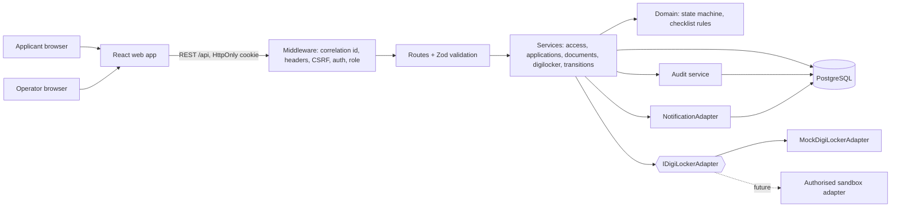

# Architecture

## High-level design

## Responsibilities
| Path | Responsibility |
|---|---|
| `frontend/` | Presentation only. Renders server-provided actions; decides nothing about permissions |
| `backend/src/routes` | HTTP and input validation |
| `backend/src/middleware` | Authentication, role gate, CSRF, headers, safe errors |
| `backend/src/services/access.ts` | The one place for ownership and operator scope, plus row locking |
| `backend/src/services/transitions.ts` | The only path that changes status |
| `backend/src/domain` | Pure rules, testable without I/O |
| `backend/src/integrations` | External providers |
| `backend/src/lib/db.ts` | Data access helpers and transactions; services own their SQL |
| `database/` | Migrations and seed |

## Adapter boundary
Services call `digiLockerFor(userId)`, typed as `IDigiLockerAdapter`. `integrations/digilocker/index.ts` is the only file that names the mock. The outage switch and simulated consent page live in `MockProviderControl`, outside the interface.

A sandbox adapter can replace the mock without changing consent, checklist or state machine logic. It is **not** a zero-change swap. You would also need: a server-side token store keyed by `providerRef` (never in these tables), PKCE, the real redirect URI and callback shape (the mock returns an HMAC-signed body, and real providers differ), provider calls moved outside the database lock, and removal of the demo routes.
