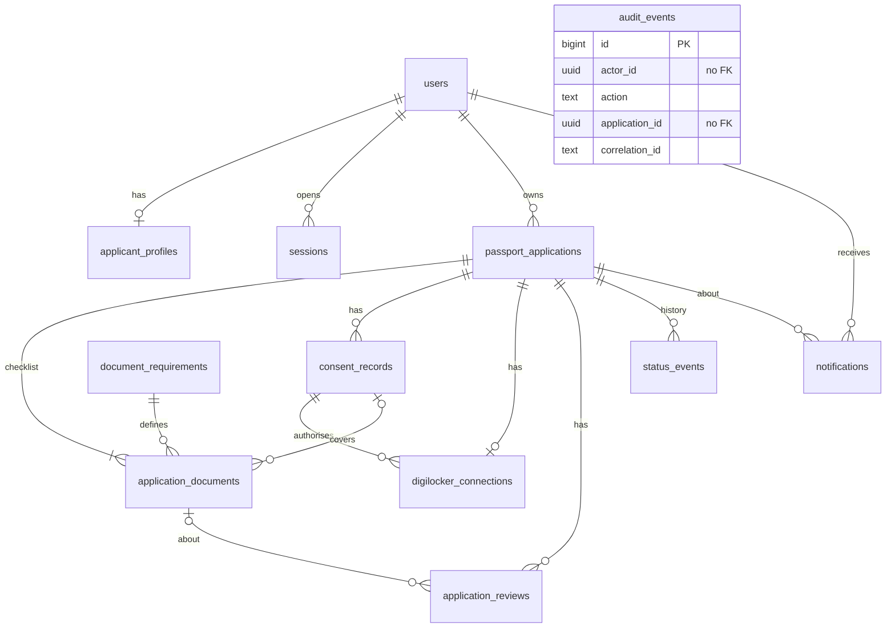

# Database

Schema: [`database/migrations/001_init.sql`](../database/migrations/001_init.sql)

## ER diagram

## Entities
| Table | Purpose | Keys, constraints, indexes |
|---|---|---|
| users | Demo accounts, role, region | PK id; unique email |
| sessions | Hashed session tokens (added entity, needed for revocable sign-in) | PK token_hash; index user_id |
| applicant_profiles | One per applicant | unique user_id |
| passport_applications | Application, status, version | unique reference; check type/scenario; indexes applicant_id, (region,status) |
| document_requirements | Configurable rules (JSON) per type and scenario | unique (type, scenario, code) |
| application_documents | One checklist item per requirement; metadata only | unique (application, requirement); rejected needs reason; DigiLocker source needs consent |
| consent_records | Grant, scopes, text version, withdrawal | partial unique index: one active per application |
| digilocker_connections | State nonce hash, expiry, callback fingerprint | unique application_id; unique nonce hash |
| application_reviews | Operator decisions | non-accept needs a reason; index (application, created_at) |
| status_events | Timeline | index (application, id) |
| notifications | In-app messages | index (user, read_at, created_at) |
| audit_events | Append-only log | trigger blocks UPDATE and DELETE (not TRUNCATE or a table owner who removes the trigger); indexes on application and actor |

## Delete behaviour
- Applications **restrict** deleting their applicant, so history is not lost by accident.
- Application children **cascade**. Requirements and consents **restrict** while referenced.
- A deleted actor in `status_events` becomes NULL; the stored actor name remains.
- `audit_events` has no foreign keys, so it outlives related records.

## Timestamps
All are `timestamptz`. Mutable tables carry `created_at` and `updated_at`, set in SQL. Event tables are insert-only. Calendar values use `date`.

## Adding a requirement
Insert a `document_requirements` row. Rules: `notExpired`, `maxAgeMonths`, `nameMustMatch`. New applications copy the matching requirements; existing ones do not change. A new document code also needs a mock catalogue entry to be discoverable.
