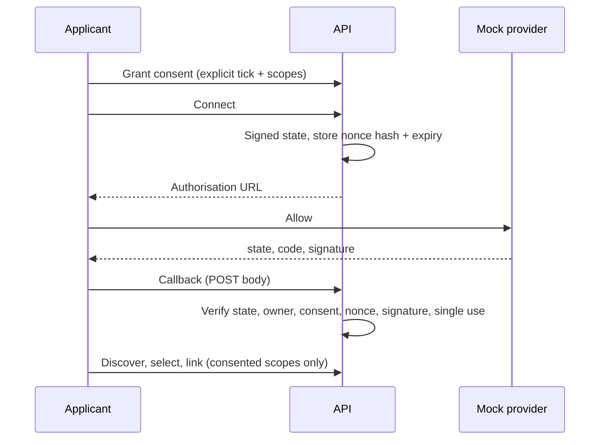

# Security and consent

## Consent flow

Purpose, scopes, wording version and grant time are stored.

## Callback safety
- 256-bit random nonce; state is HMAC-SHA256 signed over nonce, application id and expiry (10 minutes).
- The signed-in user must own the application named in the state.
- A retry issues a new nonce and invalidates older states. The database stores only the nonce hash.
- Single use is enforced under a row lock. An identical redelivery returns success with `duplicate: true` and creates nothing; a different code with a used state is STATE_REPLAYED.
- Unique constraints prevent duplicate connections and checklist items.
- The authorisation URL carries `state` and scope names. The code and signature travel only in POST bodies. The state contains an application UUID, which is an identifier, not a secret or credential.

## Revocation
In one transaction: set `withdrawn_at`; mark the connection WITHDRAWN and clear its reference; delete DigiLocker references and metadata from items (status Missing, `access_revoked_at` set); move in-review applications to Documents Pending; audit; notify. The provider revoke call follows, and its failure never blocks local revocation. A real adapter would need a retry queue for failed revocations. Old callbacks cannot reconnect. Uploads remain available when the application is editable.

## Data minimisation, retention and deletion
Only masked identifiers and metadata are shown. The README lists what is not stored.

| Data | Retention in this demo | Deletion |
|---|---|---|
| DigiLocker references and metadata | Until withdrawal | Deleted on withdrawal |
| Upload metadata | With the application | Replaced on re-upload; no delete screen |
| Consent, status, review, audit records | Indefinite, as history | No UI. Operator review reasons are free text and are kept in review history and notifications, so they must not contain sensitive values |
| Profile | Until edited | No delete screen |
| Sessions | 8 hours | Deleted on sign-out; expired rows removed at next sign-in |
| Local database | Until reset | `docker compose down -v` removes it |

Database backups, legal retention periods and erasure requests are out of scope. Earlier row versions can remain in PostgreSQL storage until vacuumed, so this is not forensic erasure.

## Access control
- Role gate on routes, and role checks in services.
- Applicant queries filter by `applicant_id` in SQL. Operator queries filter by region and review visibility.
- Documents are authorised through their parent application; item ids are matched within that application.
- Out-of-scope and missing records both return 404; denials are audited.
- Evidence: the "scenario 7" and "operator permissions" tests.

## Web protections
scrypt password hashes; random session tokens stored hashed; HttpOnly SameSite=Strict cookie; custom header and Origin check against CSRF; sign-in throttle; parameterised SQL; React output escaping; no-store and basic security headers on API responses; API bound to 127.0.0.1. The web dev server does not set a content security policy; add one for any deployment.

## Logging, audit and secrets
- Logs include only time, level, correlation id, method, path (no query), status and error class.
- Audit events hold actor, action, resource, outcome, short machine detail, correlation id and time. A test checks that codes, state, masked ids and phone numbers do not appear.
- Safe errors never include stack traces or database messages.
- Secrets come from `.env`, which Git ignores. The database password in `docker-compose.yml` and the demo password are public local-only values; never reuse them.

## Known gaps
No MFA, TLS, secret manager, shared rate limiter, per-session CSRF token, upload malware scan, or penetration test. Failed sign-in throttling is per IP and email and resets on restart. Rejected review and upload attempts that fail validation are not all audited; invalid transitions, callbacks and access denials are.
