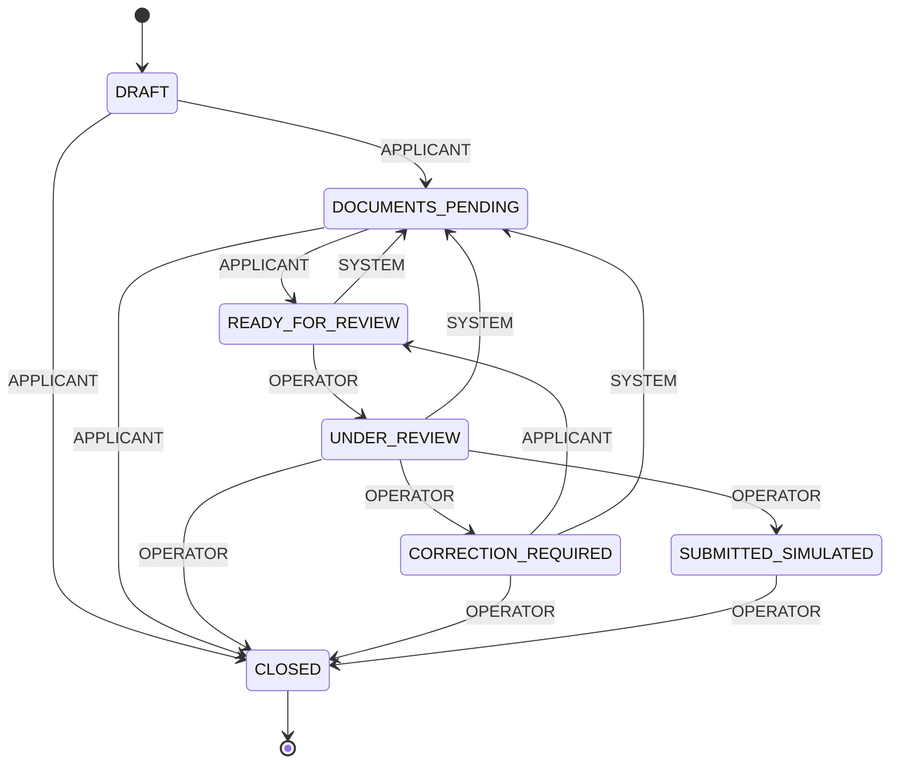

# State machine

Source of truth: `backend/src/domain/stateMachine.ts`.

UI names: SUBMITTED_SIMULATED is shown as "Submitted (simulated)".

## Transitions and roles
| From | To | Role | Reason required | Guard |
|---|---|---|---|---|
| DRAFT | DOCUMENTS_PENDING | APPLICANT | No | PROFILE_COMPLETE |
| DRAFT | CLOSED | APPLICANT | Yes | None |
| DOCUMENTS_PENDING | READY_FOR_REVIEW | APPLICANT | No | DOCUMENTS_PROVIDED |
| DOCUMENTS_PENDING | CLOSED | APPLICANT | Yes | None |
| READY_FOR_REVIEW | UNDER_REVIEW | OPERATOR | No | None |
| READY_FOR_REVIEW | DOCUMENTS_PENDING | SYSTEM | No | None |
| UNDER_REVIEW | CORRECTION_REQUIRED | OPERATOR | Yes | HAS_REJECTED_ITEM |
| UNDER_REVIEW | SUBMITTED_SIMULATED | OPERATOR | No | ALL_VERIFIED |
| UNDER_REVIEW | DOCUMENTS_PENDING | SYSTEM | No | None |
| UNDER_REVIEW | CLOSED | OPERATOR | Yes | None |
| CORRECTION_REQUIRED | READY_FOR_REVIEW | APPLICANT | No | DOCUMENTS_PROVIDED |
| CORRECTION_REQUIRED | DOCUMENTS_PENDING | SYSTEM | No | None |
| CORRECTION_REQUIRED | CLOSED | OPERATOR | Yes | None |
| SUBMITTED_SIMULATED | CLOSED | OPERATOR | Yes | None |

**Guards:** PROFILE_COMPLETE: a profile exists. DOCUMENTS_PROVIDED: every required item is Pending or Verified and none is Rejected. HAS_REJECTED_ITEM: at least one item is Rejected. ALL_VERIFIED: every required item is Verified.

**SYSTEM** transitions happen only inside consent withdrawal. No API request can act as SYSTEM.

## Invalid transition behaviour
| Cause | HTTP | Code |
|---|---|---|
| Pair not listed | 409 | INVALID_TRANSITION |
| Wrong role | 403 | ROLE_NOT_PERMITTED |
| Missing reason | 400 | REASON_REQUIRED |
| Guard not met | 409 | GUARD_FAILED |
| Outdated version | 409 | STALE_VERSION |

Nothing changes, and a TRANSITION_REJECTED audit event (outcome DENIED) is written after rollback. Requests for applications outside your scope return 404 and write ACCESS_DENIED. Requests that fail schema validation (unknown status) are rejected before reaching the state machine.

## Recorded for each success
Previous status, new status, actor id, role and name, reason (the action label if none is given) and timestamp, in `status_events`, in the same transaction as the update and audit event.

## Duplicate prevention
A row lock plus `expectedVersion`: of two identical requests, one succeeds and the other gets STALE_VERSION.
